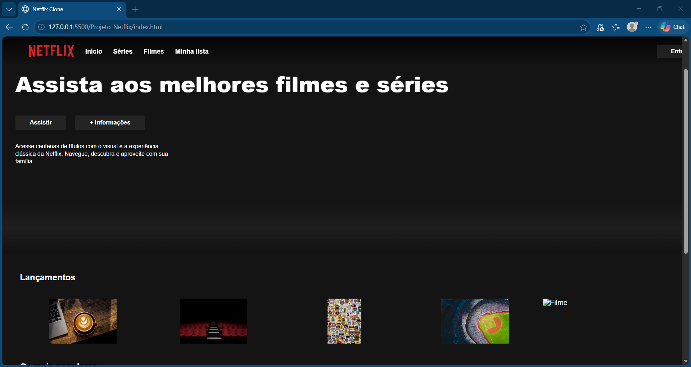

# 🎬 Página Inspirada na Netflix

Projeto de desenvolvimento web inspirado na interface de plataformas de streaming, criado para praticar e aprimorar minhas habilidades em desenvolvimento front-end.

## 📸 Prévia do projeto

## 📌 Sobre o projeto

Esta página apresenta uma interface inspirada na Netflix, com foco na organização visual dos conteúdos e na criação de uma experiência de navegação moderna.

O projeto foi desenvolvido como parte dos meus estudos em programação e desenvolvimento web.

## 🛠️ Tecnologias utilizadas

- **HTML5** — estrutura da página.
- **CSS3** — estilização e layout.
- **JavaScript** — funcionalidades e interatividade.

## ✨ Funcionalidades

- Interface inspirada em plataformas de streaming.
- Organização visual dos conteúdos.
- Estilização personalizada.
- Recursos interativos desenvolvidos com JavaScript.

*Observação: mantenha apenas as funcionalidades que realmente existem no seu projeto.*

## 🚀 Como executar

1. Baixe ou clone este repositório.
2. Abra a pasta do projeto.
3. Execute o arquivo `index.html` no navegador.

## 🎯 Objetivo

Praticar desenvolvimento front-end, aprimorar minhas habilidades com HTML, CSS e JavaScript e construir projetos para meu portfólio profissional.

## 👨‍💻 Desenvolvedor

**Guilherme Silva**

Estudante de Informática para Internet, interessado em programação, desenvolvimento web e criação de soluções digitais.

---

⭐ Projeto desenvolvido para fins de estudo e portfólio.

*Este projeto é inspirado na interface de uma plataforma de streaming e não possui vínculo oficial com a Netflix.*